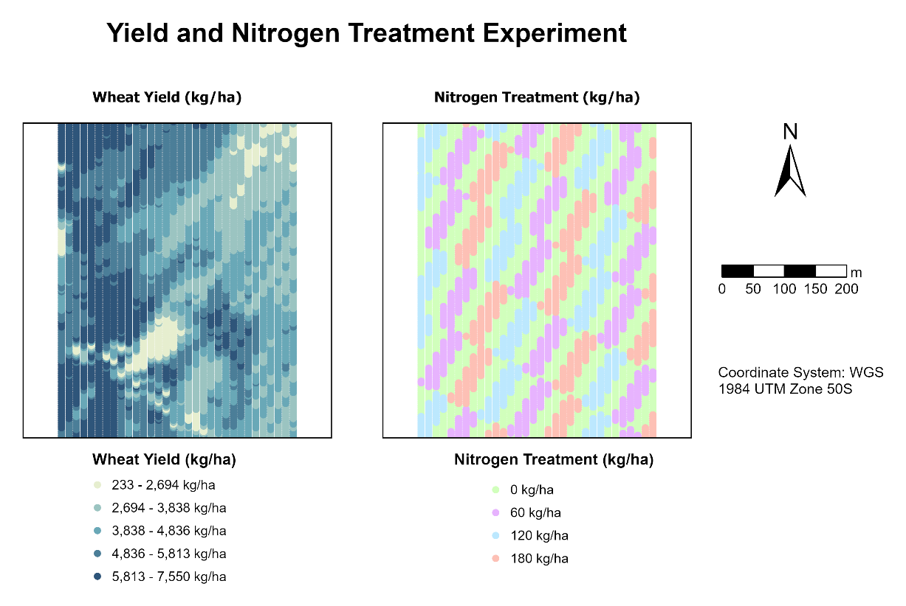
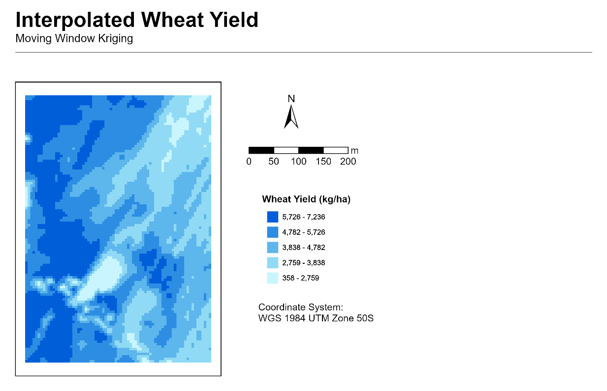
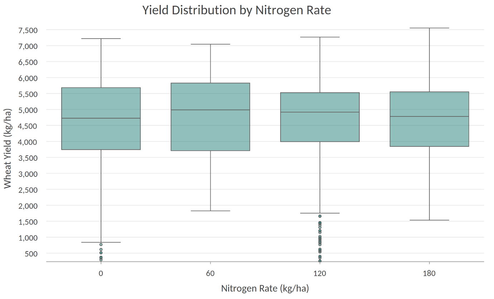
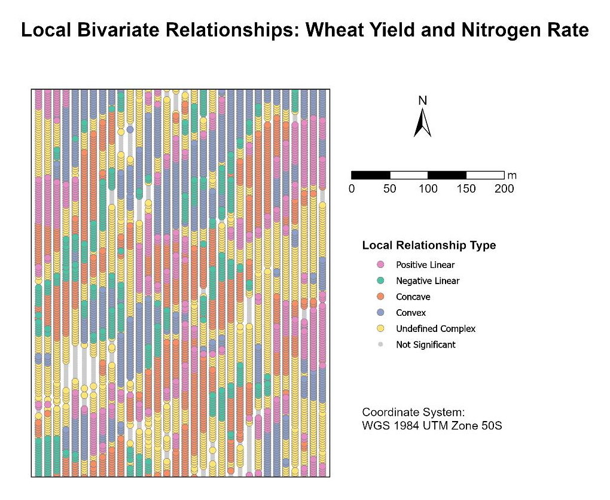

# Wheat Yield and Nitrogen Response: A Spatial Analysis

A spatial analysis of an on-farm wheat experiment: mapping yield and nitrogen treatments, interpolating a continuous yield surface with Moving Window Kriging, testing treatment differences, and mapping local associations between nitrogen rate and yield across the paddock.

> **About this project:** a guided laboratory exercise for SPAT5008 Applied GIS at Curtin University, using a supplied teaching dataset with fabricated locations. It demonstrates GIS and statistical methods. It is not original agronomic research, and its findings should not be applied to a real paddock.

## Problem

Does applying more nitrogen produce more wheat, and is the pattern the same everywhere in a paddock? The exercise explores this by combining mapping, geostatistics, statistical tests and local relationship analysis.

## Data

- **Dataset:** `YieldPt2`, a yield-monitor point dataset supplied for the unit (5,728 points).
- **Variables used:** wheat yield (`Yield`, kg/ha) and nitrogen treatment rate (`RateNit`).
- **Treatments:** four nitrogen rates (0, 60, 120 and 180 kg/ha) applied in a checkerboard-style design.
- **Coordinate system:** WGS 1984 UTM Zone 50S.
- **Locations:** fabricated for the teaching exercise, so no basemap is used.
- **Not included:** the supplied dataset is not redistributed in this repository.

## Method

1. **Visualise the experiment:** map yield (five graduated classes) alongside the four nitrogen treatments.
2. **Interpolate yield:** fit an Ordinary Kriging model, then use it as the source for Moving Window Kriging (100-point neighbourhood, 5 m output cells).
3. **Explore the relationship:** scatter plot with a linear trend line, plus a boxplot of yield by nitrogen rate.
4. **Test for differences:** calculate the mean yield for each treatment, then run pairwise Z-tests (α = 0.05, critical Z = ±1.96) in a Jupyter Notebook.
5. **Map local associations:** use the Local Bivariate Relationships tool to classify local associations between nitrogen rate and wheat yield.

## Key results

| Nitrogen rate (kg/ha) | Points (n) | Mean yield (kg/ha) |
|---|---|---|
| 0 | 2,875 | 4,679.29 |
| 60 | 1,054 | 4,782.16 |
| 120 | 944 | 4,716.36 |
| 180 | 855 | 4,716.57 |

- **Overall pattern:** median yields were broadly similar across the four rates, with substantial overlap between groups and no consistent increase as nitrogen rate increased. The linear trend was essentially flat (y = 4,695.86 + 0.2432x, R² = 0.00018).
- **Pairwise Z-tests:** only the 0 versus 60 kg/ha comparison met the unadjusted α = 0.05 threshold (Z = −2.372, p = 0.018). It would not remain significant under a Bonferroni adjustment for six comparisons. The other five comparisons had p-values from 0.223 to 0.997.
- **Spatial variation:** yield formed coherent patches, with higher yields concentrated in the west of the paddock. The local relationship map showed all six relationship types (Positive Linear, Negative Linear, Concave, Convex, Undefined Complex and Not Significant). Local associations varied in shape and direction across the paddock.

## Maps and charts

*Figure 1. Wheat yield (left) and the checkerboard nitrogen treatment design (right) across the experimental paddock.*

*Figure 2. Predicted wheat yield using Moving Window Kriging, with a 100-point neighbourhood and 5 m output cells.*

*Figure 3. Wheat yield distributions across four nitrogen treatments (0, 60, 120 and 180 kg/ha; n = 2,875, 1,054, 944 and 855 points, respectively). Median yields were broadly similar, with substantial overlap between groups and no consistent increase as nitrogen rate increased.*

*Figure 4. Local Bivariate Relationships between wheat yield and nitrogen rate, showing six local relationship types across the paddock.*

All figures were produced during a guided laboratory exercise using a supplied teaching dataset with fabricated locations.

## Limitations

- **Teaching exercise:** the data are a supplied teaching dataset with fabricated locations, so the results describe this dataset, not a real paddock.
- **Multiple comparisons:** six pairwise tests were run at α = 0.05 with no correction. Against a Bonferroni threshold of about 0.008 (0.05 ÷ 6), the 0 versus 60 kg/ha result (p = 0.018) would not be significant. Treat it as suggestive, not conclusive.
- **Spatial dependence:** spatial dependence between nearby observations may affect the independence assumption behind the Z-tests. Its extent and effect were not assessed.
- **Unequal group sizes:** treatment groups range from 855 to 2,875 observations. Unequal sample sizes can affect the precision of treatment estimates; precision also depends on within-group variability and spatial dependence.
- **Linear trend:** nitrogen was applied at four fixed rates, so a straight line is a limited summary of the pattern.
- **Local associations:** the mapped relationship types describe local statistical associations, not recommended nitrogen rates. Some of the example neighbourhoods examined in the original report had low adjusted R² (for example 0.085 and 0.10).
## Tools and skills

- **Tools:** ArcGIS Pro (kriging, Summary Statistics, Local Bivariate Relationships, layouts and cartography) and a Jupyter Notebook (pairwise Z-tests).
- **Skills demonstrated:** spatial interpolation and geostatistics, experimental design interpretation, hypothesis testing, spatial pattern analysis, cartography, and clear reporting of limitations.

## Workflow overview

This outlines the workflow only. The dataset and notebook are not included, so it does not support exact reproduction.

1. Add the yield-monitor point layer to a map using WGS 1984 UTM Zone 50S.
2. Symbolise yield in five graduated classes and nitrogen rate as four unique values, and place the two maps side by side.
3. Fit an Ordinary Kriging model to the yield field, then run Moving Window Kriging using that model as the source (100-point neighbourhood, 5 m output cell size).
4. Plot yield against nitrogen rate as a scatter plot with a linear trend line, and as a boxplot by rate.
5. Run Summary Statistics to obtain the count and mean yield for each nitrogen rate.
6. In a Jupyter Notebook, compare each pair of treatments with a Z-test using the group means, variances and counts, and compare Z with ±1.96.
7. Run Local Bivariate Relationships for nitrogen rate and yield, and map the resulting relationship types.

## Data and attribution

- **Data:** supplied teaching dataset (SPAT5008 Applied GIS, Curtin University). It is not redistributed here and remains subject to the unit's conditions.
- **Maps and charts:** produced by the author for this exercise. No basemap or third-party imagery is used.
- **Copyright:** © 2026 Moshraf Hossain. All rights reserved in my original text and cartographic contributions. Supplied teaching materials and any third-party content are excluded from this notice and remain subject to their respective terms.

## Acknowledgement

Completed as part of SPAT5008 Applied GIS, Curtin University.

## Contact

Moshraf Hossain: [LinkedIn](https://linkedin.com/in/moshrafhossain) · [Portfolio](https://moshraf.github.io/)
